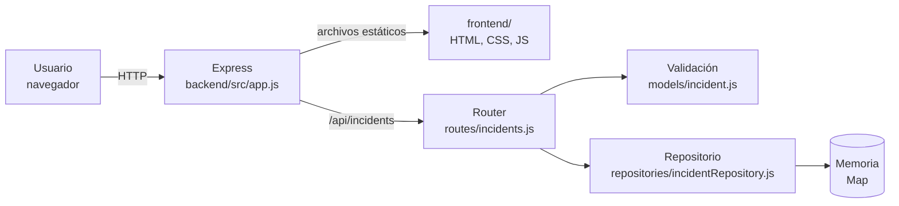

# Arquitectura

## Visión general

ArrowOps es una aplicación web monolítica con dos capas: una API REST en Node.js + Express 5 y un frontend estático que el mismo proceso sirve. El navegador y la API comparten origen, así que no hace falta configurar CORS.

## Componentes

| Componente | Ubicación | Responsabilidad |
|---|---|---|
| Servidor | `backend/src/server.js` | Carga la configuración y arranca la app |
| Configuración | `backend/src/config.js` | Lee y valida `PORT` y `NODE_ENV` desde variables de entorno (ver `.env.example`) |
| Aplicación | `backend/src/app.js` | `createApp({ repository })`: middleware JSON, rutas, archivos estáticos y manejo de errores (400, 404, 500) |
| Rutas | `backend/src/routes/incidents.js` | Endpoints del CRUD; traduce los resultados a códigos HTTP |
| Modelo | `backend/src/models/incident.js` | Estados y prioridades válidos; `validateIncident()` |
| Repositorio | `backend/src/repositories/incidentRepository.js` | Persistencia: crear, listar con filtros, buscar, actualizar y eliminar |
| Frontend | `frontend/` | `index.html`, `src/api.js` (cliente HTTP), `src/form.js` (formulario), `src/app.js` (tabla y eventos) |
| Pruebas | `tests/api/` | Jest + Supertest contra la app en memoria |
| Base de datos | `database/` | Reservado para la persistencia real (ver deuda TD-01) |

## Modelo de datos: incidente

| Campo | Tipo | Reglas |
|---|---|---|
| `id` | UUID | Generado por el servidor |
| `title` | texto | Obligatorio, máximo 120 caracteres |
| `description` | texto | Obligatorio, máximo 2000 caracteres |
| `priority` | enum | `baja`, `media`, `alta`, `critica` |
| `status` | enum | `abierto` (por defecto), `en_progreso`, `resuelto`, `cerrado` |
| `reporter` | texto o null | Opcional |
| `createdAt` / `updatedAt` | ISO 8601 | Generados por el servidor |

## API

| Método | Ruta | Respuestas |
|---|---|---|
| `GET` | `/health` | 200 |
| `GET` | `/api/incidents?status=&priority=` | 200, 400 (filtro inválido) |
| `GET` | `/api/incidents/:id` | 200, 404 |
| `POST` | `/api/incidents` | 201 + `Location`, 400 |
| `PUT` | `/api/incidents/:id` | 200, 400, 404 |
| `DELETE` | `/api/incidents/:id` | 204, 404 |

Los errores siempre responden con el formato `{ "errors": ["mensaje", ...] }`.

## Decisiones técnicas

| Decisión | Motivo | Consecuencia |
|---|---|---|
| Repositorio inyectable en `createApp()` | Cada prueba usa una instancia aislada | Cambiar a una base de datos real solo requiere otra implementación del repositorio |
| Repositorio en memoria | Entregar el CRUD rápido en v0.x | Los datos se pierden al reiniciar (deuda TD-01) |
| Frontend sin framework ni build | Menos dependencias y un pipeline más simple | Hay que escapar el HTML a mano (ver [seguridad.md](seguridad.md)) |
| Frontend servido por Express | Un único proceso y un único artefacto, sin CORS | El frontend y la API se despliegan juntos |
| Un solo `package.json` en la raíz | Un solo `npm ci`, `npm test` y `npm pack` en el pipeline | El backend y el frontend comparten versión |

## Flujo de entrega

| Etapa | Herramienta | Estado |
|---|---|---|
| Planificación | Azure Boards: Epics, Features, Stories, Tasks y Sprints 1 a 3 | Implementado |
| Código y revisión | GitHub: ramas `feature/*`, `fix/*`, `refactor/*`, PR y `main` protegida | Implementado |
| CI | Azure Pipelines: pipeline `ArrowOps-CI` (`azure-pipelines.yml`) en el agente autohospedado `PC-EMILIO` (pool `ArrowOps-SelfHosted`) | Implementado |
| Checks de PR | GitHub Actions, workflow `PR checks` (`.github/workflows/pr-checks.yml`): build y pruebas en Linux con Node 20 y 22, audit de producción y `dependency-review` | Implementado |
| Actualización de dependencias | Dependabot (`.github/dependabot.yml`): PR semanales para npm y GitHub Actions | Implementado |
| Release | Artefacto versionado y ambientes `dev` → `prod` con aprobación | Planificado (Fase 3) |
