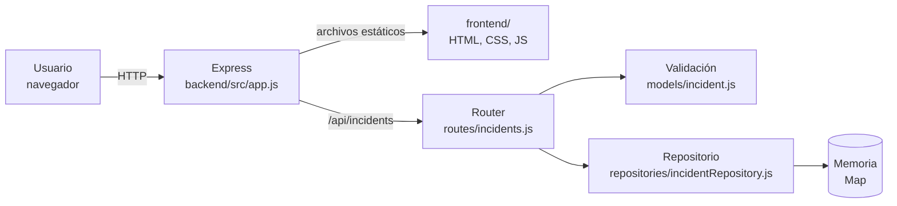
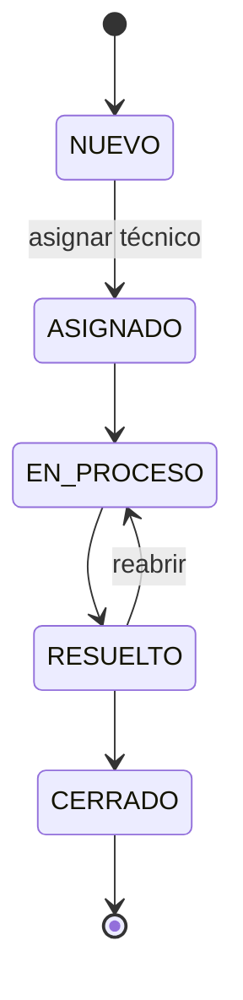

# Arquitectura

## Visión general

ArrowOps es una aplicación web monolítica: una API REST en Node.js + Express 5, un frontend estático que el mismo proceso sirve y una base de datos PostgreSQL 17 en Docker. El navegador y la API comparten origen, así que no hace falta configurar CORS.

## Componentes

| Componente | Ubicación | Responsabilidad |
|---|---|---|
| Servidor | `backend/src/server.js` | Carga la configuración y arranca la app |
| Configuración | `backend/src/config.js` | Lee y valida `PORT` y `NODE_ENV` desde variables de entorno (ver `.env.example`) |
| Aplicación | `backend/src/app.js` | `createApp({ repository })`: middleware JSON, rutas, archivos estáticos y manejo de errores (400, 404, 500) |
| Rutas | `backend/src/routes/incidents.js` | Endpoints del CRUD; traduce los resultados a códigos HTTP |
| Modelo | `backend/src/models/incident.js` | Estados y prioridades válidos; `validateIncident()` |
| Repositorio PostgreSQL | `backend/src/repositories/postgresIncidentRepository.js` | Persistencia real con consultas parametrizadas (asíncrono) |
| Repositorio en memoria | `backend/src/repositories/incidentRepository.js` | Misma interfaz sobre un `Map`; se usa sin `DATABASE_URL` (desarrollo rápido y pruebas unitarias) |
| Frontend | `frontend/` | `index.html`, `src/api.js` (cliente HTTP), `src/form.js` (formulario), `src/dashboard.js` (indicadores), `src/app.js` (filtros, tabla, operaciones e historial) |
| Pruebas | `tests/api/`, `tests/contract/` | Jest + Supertest. Las **pruebas de contrato** corren la misma batería contra los dos repositorios; las de PostgreSQL se ejecutan si hay `DATABASE_URL` (siempre en CI) |
| Ejecución completa | `docker-compose.yml` y `Dockerfile` (raíz) | Un `docker compose up` levanta la app (construida desde el código con el mismo empaquetado del CI) y PostgreSQL con esquema y datos de ejemplo |
| Base de datos | `database/` | `docker-compose.yml` (PostgreSQL 17, puerto 5433), `schema.sql` (tabla `incidents` con restricciones e índices) y `seed.sql` |

## Modelo de datos: incidente

| Campo | Tipo | Reglas |
|---|---|---|
| `id` | UUID | Generado por el servidor |
| `title` | texto | Obligatorio, máximo 120 caracteres |
| `description` | texto | Obligatorio, máximo 2000 caracteres |
| `category` | enum | `hardware`, `software`, `red`, `accesos`, `otro` (obligatoria) |
| `priority` | enum | `baja`, `media`, `alta`, `critica` |
| `status` | enum | `NUEVO` (al crear), `ASIGNADO`, `EN_PROCESO`, `RESUELTO`, `CERRADO`. Solo cambia por el flujo (ver abajo) |
| `technician` | `{ id, name }` o null | Técnico asignado, del catálogo `technicians` |
| `reporter` | texto o null | Usuario que reporta |
| `createdAt` / `updatedAt` | ISO 8601 | Generados por el servidor |

### Flujo de estados

Las reglas están en `backend/src/models/incident.js`:
- No se pueden saltar pasos.
- `ASIGNADO` solo se alcanza asignando un técnico.
- `EN_PROCESO`, `RESUELTO` y `CERRADO` exigen un técnico asignado.
- Se puede reasignar en `NUEVO`, `ASIGNADO` o `EN_PROCESO`.
- `CERRADO` es un estado final.

Una transición inválida responde **409 Conflict** con un mensaje que indica qué está permitido.

### Bitácora (seguimiento)

Cada incidente tiene un historial en la tabla `incident_events`. Se registra automáticamente cada vez que el incidente se **crea**, se **edita**, se **asigna o reasigna** y **cambia de estado** (con el estado anterior y el nuevo). Además admite **comentarios** manuales. Las operaciones aceptan un `author` opcional y las que se rechazan no quedan registradas. Al eliminar un incidente se elimina su historial (`ON DELETE CASCADE`).

### Indicadores (dashboard)

`backend/src/models/stats.js` calcula los indicadores con una función pura, la misma para los dos módulos de datos:

| Indicador | Definición |
|---|---|
| Abiertos | `NUEVO` + `ASIGNADO` + `EN_PROCESO` (todavía requieren trabajo) |
| Cerrados | `CERRADO` |
| Críticos | Prioridad `critica` y todavía abiertos |
| Por categoría | Todos los incidentes, por `category` |
| Por técnico | Incidentes **abiertos** por técnico (carga de trabajo), con `Sin asignar` aparte |

Cada indicador es clicable y aplica a la lista el mismo criterio con el que se calculó: *Abiertos* → `open=true`; *Críticos* → `open=true&priority=critica`; *Cerrados* → `status=CERRADO`; una categoría → `category=…`; un técnico → `open=true&technicianId=…` (`none` para *Sin asignar*). Así, el número de la tarjeta coincide con las filas que se muestran.

## API

| Método | Ruta | Respuestas |
|---|---|---|
| `GET` | `/health` | 200 `{ status, version }` |
| `GET` | `/api/incidents?status=&open=&priority=&category=&technicianId=` | 200, 400 (filtro inválido). `open=true`: NUEVO, ASIGNADO o EN_PROCESO; `technicianId=none`: sin técnico |
| `GET` | `/api/incidents/:id` | 200, 404 |
| `POST` | `/api/incidents` | 201 + `Location` (nace `NUEVO`), 400 |
| `PUT` | `/api/incidents/:id` | 200 (edita los datos; no el estado ni el técnico), 400, 404 |
| `PATCH` | `/api/incidents/:id/assign` `{ technicianId }` | 200, 400, 404, 409 |
| `PATCH` | `/api/incidents/:id/status` `{ status }` | 200, 400, 404, 409 |
| `DELETE` | `/api/incidents/:id` | 204, 404 |
| `GET` | `/api/incidents/:id/history` | 200 (bitácora en orden cronológico), 404 |
| `POST` | `/api/incidents/:id/comments` `{ message, author? }` | 201, 400, 404 |
| `GET` | `/api/stats` | 200: `total`, `abiertos`, `resueltos`, `cerrados`, `criticos`, `porEstado`, `porCategoria` y `porTecnico` |
| `GET` | `/api/technicians` | 200 (técnicos activos) |
| `GET` | `/api/meta` | 200: estados, prioridades, categorías y transiciones. La interfaz los toma de aquí para no duplicar las reglas |

Los errores siempre responden con el formato `{ "errors": ["mensaje", ...] }`.

### Migraciones de base de datos

El esquema se versiona en `database/migrations/NNN_descripcion.sql`. Al arrancar con `DATABASE_URL`, la app (`backend/src/db/migrate.js`):
1. aplica en orden las migraciones pendientes, cada una en su propia transacción;
2. las registra en `schema_migrations`;
3. usa un *advisory lock* para que dos procesos no migren a la vez.

Así, cada despliegue a `dev` o `prod` actualiza la base sin pasos manuales y conserva los datos. Por ejemplo, la migración `002` convierte los estados de v1 (`abierto` → `NUEVO`, etc.).

## Decisiones técnicas

| Decisión | Motivo | Consecuencia |
|---|---|---|
| Repositorio inyectable en `createApp()` | Cada prueba usa una instancia aislada | Cambiar a una base de datos real solo requiere otra implementación del repositorio |
| PostgreSQL en Docker (TD-01) | Persistencia real con restricciones en la base de datos; Docker da el mismo motor en desarrollo y en los dos CI | El agente autohospedado necesita Docker Desktop corriendo |
| Repositorio elegido por `DATABASE_URL` | Desarrollo y pruebas unitarias rápidas sin base de datos | Las pruebas de contrato garantizan que ambas implementaciones se comportan igual |
| Rutas `async` con Express 5 | Express 5 envía las promesas rechazadas al manejador de errores | No hace falta `try/catch` en cada ruta |
| Frontend sin framework ni build | Menos dependencias y un pipeline más simple | Hay que escapar el HTML a mano (ver [seguridad.md](seguridad.md)) |
| Frontend servido por Express | Un único proceso y un único artefacto, sin CORS | El frontend y la API se despliegan juntos |
| Un solo `package.json` en la raíz | Un solo `npm ci`, `npm test` y `npm pack` en el pipeline | El backend y el frontend comparten versión |

## Flujo de entrega

| Etapa | Herramienta | Estado |
|---|---|---|
| Planificación | Azure Boards: Epics, Features, Stories, Tasks y Sprints 1 a 3 | Implementado |
| Código y revisión | GitHub: ramas `feature/*`, `fix/*`, `refactor/*`, PR y `main` protegida | Implementado |
| CI | Azure Pipelines: pipeline `ArrowOps-CI` (`azure-pipelines.yml`) en el agente autohospedado `PC-EMILIO` (pool `ArrowOps-SelfHosted`) | Implementado |
| Checks de PR | GitHub Actions, workflow `PR checks` (`.github/workflows/pr-checks.yml`): build y pruebas en Linux con Node 20 y 22, audit de producción y `dependency-review` | Implementado |
| Actualización de dependencias | Dependabot (`.github/dependabot.yml`): PR semanales para npm y GitHub Actions | Implementado |
| Release | Imagen Docker desde el artefacto; ambientes `arrowops-dev` (:8081) y `arrowops-prod` (:8080) en el agente, con aprobación manual antes de `prod`, health check con verificación de versión y GitHub Release (ver [release.md](release.md)) | Implementado |
