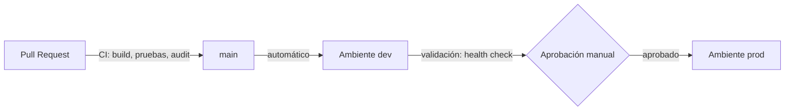

# Estrategia de release

## Versionado semántico

Se sigue [Semantic Versioning 2.0.0](https://semver.org/lang/es/): `MAJOR.MINOR.PATCH`.

| Parte | Se incrementa cuando |
|---|---|
| `MAJOR` | Hay cambios incompatibles en la API. `1.0.0` marca la primera versión estable |
| `MINOR` | Hay funcionalidad nueva compatible |
| `PATCH` | Hay correcciones compatibles |

Mientras la versión sea `0.y.z`, la API se considera en desarrollo.

La versión vive en `package.json` y se marca con un **tag anotado** `vX.Y.Z` sobre el commit de `main` que corresponde.

## Secuencia de versiones

| Versión | Contenido | Commit / PR | Estado |
|---|---|---|---|
| v0.1.0 | API: registrar incidentes (`POST /api/incidents`) | PR #1 | Publicada (tag) |
| v0.2.0 | CRUD completo e interfaz web | PR #2 a #4 | Publicada (tag) |
| v0.3.0 | Integración continua: Azure Pipelines, GitHub Actions y artefacto | Fase 2 | Planificada |
| v0.4.0 | Calidad y seguridad: pruebas, análisis de dependencias, agente autohospedado | Fase 2 | Planificada |
| v0.4.x | Correcciones (por ejemplo, del fallo controlado o de la deuda técnica) | Fase 2–3 | Planificada |
| v1.0.0 | Primera versión estable: deuda técnica priorizada resuelta y release a `prod` | Fase 3 | Planificada |

## Artefacto

*Planificado (Fase 2):* el pipeline genera un único artefacto versionado con `npm pack`, `arrowops-<version>.tgz`. Contiene `backend/`, `frontend/` y `package.json`, sin pruebas ni dependencias de desarrollo. Se publica como artefacto de Azure Pipelines y, en las versiones etiquetadas, también como GitHub Release.

## Ambientes y controles

*Planificado (Fase 3):*

| Ambiente | Disparador | Controles |
|---|---|---|
| `dev` | Cada merge a `main` | Pipeline en verde: build, pruebas y `npm audit` sin vulnerabilidades altas |
| `prod` | Tag `vX.Y.Z` o promoción manual | Despliegue previo exitoso en `dev`, **aprobación manual** en el Environment de Azure Pipelines y health check (`GET /health`) después del despliegue |

## Rollback

Para volver atrás se despliega de nuevo el artefacto de la versión anterior (`arrowops-<version-anterior>.tgz`), que queda conservado en los artefactos del pipeline y en GitHub Releases. No hace falta reconstruirlo.

## Checklist de release

- [ ] Todos los PR del alcance integrados en `main` con CI en verde.
- [ ] `package.json` con la versión nueva.
- [ ] Tag anotado `vX.Y.Z` creado y publicado.
- [ ] Artefacto generado y publicado.
- [ ] Despliegue en `dev` validado.
- [ ] Aprobación de `prod` registrada.
- [ ] Work Items del alcance en `Closed`.
