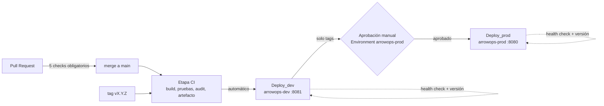

# Estrategia de release

## Versionado semántico

Se sigue [Semantic Versioning 2.0.0](https://semver.org/lang/es/): `MAJOR.MINOR.PATCH`.

| Parte | Se incrementa cuando |
|---|---|
| `MAJOR` | Hay cambios incompatibles en la API. `1.0.0` marca la primera versión estable |
| `MINOR` | Hay funcionalidad nueva compatible |
| `PATCH` | Hay correcciones compatibles |

Mientras la versión sea `0.y.z`, la API se considera en desarrollo.

La versión vive en `package.json` y se marca con un **tag anotado** `vX.Y.Z` sobre el commit de `main` que corresponde.

## Secuencia de versiones

| Versión | Contenido | Commit / PR | Estado |
|---|---|---|---|
| v0.1.0 | API: registrar incidentes (`POST /api/incidents`) | PR #1 | Publicada (tag) |
| v0.2.0 | CRUD completo e interfaz web | PR #2 a #4 | Publicada (tag) |
| v0.3.0 | Integración continua: Azure Pipelines en el agente autohospedado, artefacto, GitHub Actions y Dependabot | PR #6 a #8 | Publicada (tag) |
| v0.4.0 | Calidad y seguridad: Express 5 y jest 30 (Dependabot), configuración por variables de entorno, 100% de cobertura de líneas con umbral en CI, escaneo de secretos con gitleaks | PR #9 a #14 | Publicada (tag) |
| v1.0.0 | **Primera versión estable:** persistencia en PostgreSQL (TD-01), finales de línea normalizados (TD-02), ambientes `dev` y `prod` en Docker con aprobación manual y GitHub Release | PR #15 a #17 | Ver checklist |

## Artefacto

**Implementado.** El pipeline `ArrowOps-CI` genera un único artefacto versionado con `npm pack`, `arrowops-<version>.tgz`. Solo contiene lo que se ejecuta en producción, según el campo `files` de `package.json`: `backend/src`, `frontend/`, `README.md` y `package.json` (12 archivos, sin pruebas ni dependencias de desarrollo). Se publica como el artefacto de pipeline `arrowops`. En las versiones etiquetadas se publica también como **GitHub Release**, con el `.tgz` adjunto.

Para desplegarlo, el pipeline construye una **imagen Docker a partir del mismo `.tgz`** (`devops/deploy/Dockerfile`): se despliega exactamente lo que pasó las pruebas, sin volver a compilar desde el código. La imagen usa `node:22-alpine`, instala solo las dependencias de producción, corre como usuario `node` (no root) e incluye un `HEALTHCHECK`.

Para instalarlo en un servidor:

```bash
npm install --omit=dev ./arrowops-<version>.tgz
node node_modules/arrowops/backend/src/server.js
```

## Ambientes y controles

**Implementado** en `azure-pipelines.yml`, con la plantilla `devops/deploy/deploy-steps.yml` (los dos ambientes se despliegan con los mismos pasos).



| Ambiente | Environment de Azure | URL | Disparador | Controles |
|---|---|---|---|---|
| `dev` | `arrowops-dev` | http://localhost:8081 | Cada merge a `main` y cada tag `v*` (nunca en PR) | Etapa CI en verde: build, 55 pruebas con umbral de cobertura, `npm audit` sin vulnerabilidades altas en producción. Health check posterior al despliegue |
| `prod` | `arrowops-prod` | http://localhost:8080 | Solo tags `vX.Y.Z` | Despliegue en `dev` exitoso, **aprobación manual** (*Approvals and checks* del Environment), health check y **verificación de que la versión desplegada es la del tag** |

**Cómo es cada ambiente:** un proyecto de Docker Compose (`devops/deploy/docker-compose.yml`) en el agente autohospedado, con dos contenedores:

- `app`: la imagen `arrowops:<versión>`, publicada en el puerto del ambiente.
- `db`: PostgreSQL 17 con **volumen persistente propio**. Los datos sobreviven a los despliegues y cada ambiente tiene sus propios datos. La base de datos **no publica puertos**: solo la app puede alcanzarla.

**Secretos por ambiente:** `dev` usa la variable secreta `POSTGRES_PASSWORD` y `prod` usa **otra distinta**, `POSTGRES_PASSWORD_PROD`. Las dos son variables secretas del pipeline y nunca se guardan en el repo.

**Validación posterior al despliegue:** se consulta `GET /health` del ambiente (hasta 10 intentos) y se exige `status: ok` y `version` igual a la del artefacto. Si el ambiente sigue con la versión anterior, el despliegue falla.

## Rollback

Para volver atrás se despliega de nuevo una versión anterior, sin reconstruir nada:

1. **Desde Azure Pipelines (recomendado):** en *Pipelines → ArrowOps-CI*, abrir la ejecución del tag de la versión estable anterior y pulsar **Rerun** en la etapa `Deploy_prod`. Aplica desde v1.0.0: las versiones 0.x no tenían etapas de despliegue. Se vuelve a desplegar el artefacto de esa ejecución y pasa por la misma aprobación.
2. **Manual en el agente,** si la imagen anterior sigue en Docker:
   ```bash
   APP_VERSION=<version-anterior> APP_PORT=8080 POSTGRES_PASSWORD=<secreto> \
     docker compose -p arrowops-prod -f devops/deploy/docker-compose.yml up -d --wait
   ```

El volumen de datos no se toca en un rollback. Los cambios de esquema son aditivos (`CREATE ... IF NOT EXISTS`), así que una versión anterior sigue siendo compatible con la base de datos.
## Checklist de release v1.0.0

- [ ] Todos los PR del alcance integrados en `main` con CI en verde.
- [ ] `package.json` con la versión nueva.
- [ ] Tag anotado `vX.Y.Z` creado y publicado.
- [ ] Artefacto generado y publicado.
- [ ] Despliegue en `dev` validado.
- [ ] Aprobación de `prod` registrada.
- [ ] Work Items del alcance en `Closed`.
